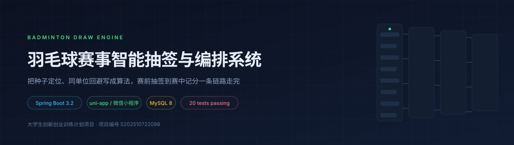
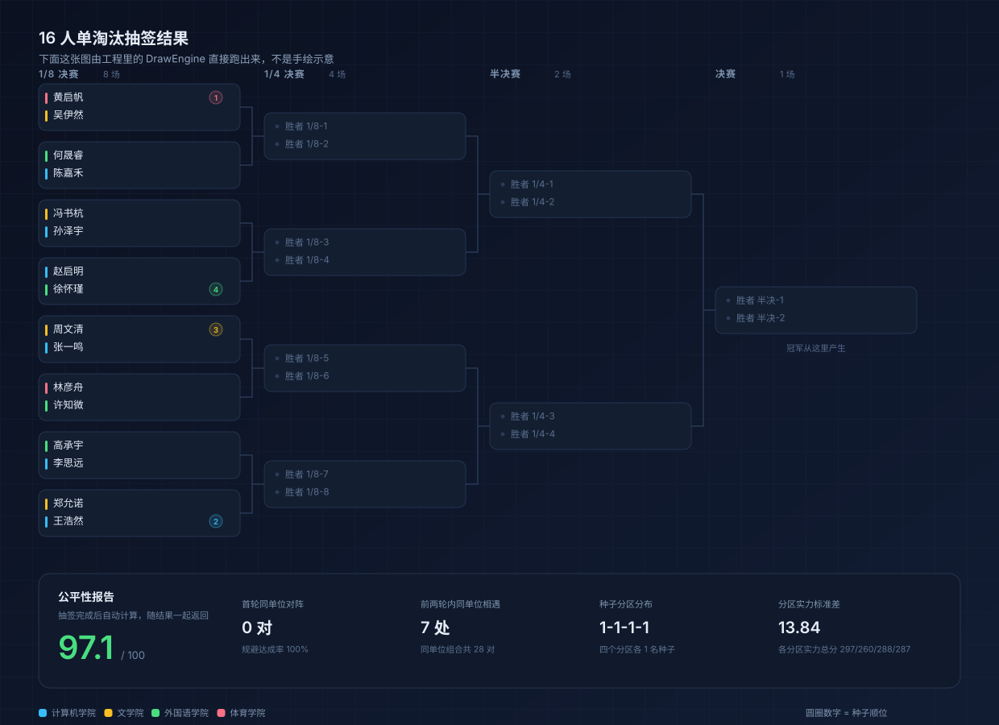
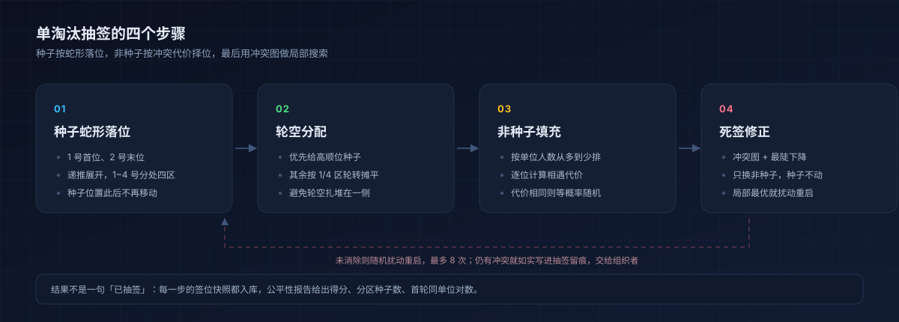
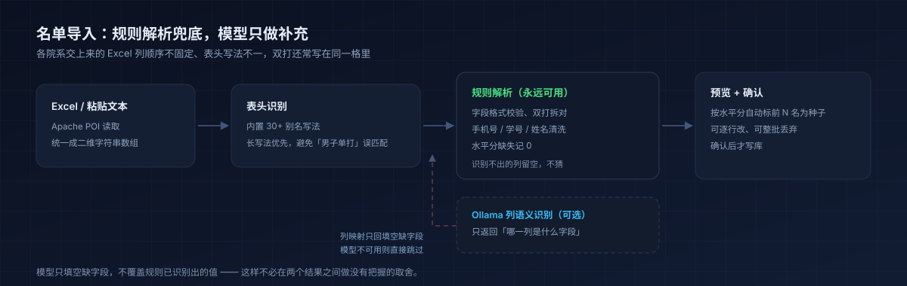
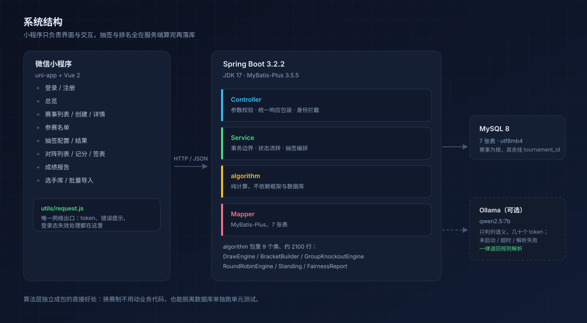

<div align="center">
  
</div>

<p align="center">
  <b>中文</b> · <a href="README_EN.md">English</a>
</p>

<p align="center">
  
  
  
  
  
  
</p>

高校羽毛球比赛的组织工作，大多还是纸签筒加 Excel。人一多，三个问题立刻显出来：种子分没分匀只有组织者心里有数，同学院的两个人在第一轮撞上也说不清是不是运气，名单一改，整张对阵表得重排一遍。

这套系统把竞赛规则里的种子定位、同单位回避拆成能计算的条件，然后把名单导入、抽签编排、逐场记分、成绩报告串成一条链路。前端是微信小程序，后端 Spring Boot，**抽签算法单独成包，不依赖数据库也能跑单元测试**。

## 抽签结果长什么样



上面这张图不是手绘示意，是工程里的 `DrawEngine` 跑一份 16 人名单直接出的结果：4 名种子分处四个分区，首轮 8 场没有一场同单位对阵，公平性得分 97.1。同一个引擎在 `mvn test` 里被 19 个用例覆盖。

图里的规则细节：

- 1 号种子固定在首位，2 号种子在末位，两人最早只能在决赛相遇
- 3、4 号种子落在上下半区的中间位置，四个 1/4 区各一名
- 首轮同单位对数为 0，前两轮内还剩 7 处同单位相遇（16 人里 4 个单位、最多的一个单位报了 6 人，压到零不现实）
- 每张卡片右侧的圆圈数字是种子顺位，左侧色条是所属单位

## 这个系统做了什么

| | 功能 | 说明 |
|---|---|---|
| 🎯 | 智能抽签 | 种子蛇形落位，非种子按冲突代价择位，死签用冲突图做局部搜索修正 |
| 🧮 | 两种赛制 | 单淘汰、小组循环加交叉淘汰；单循环的轮转算法在小组赛内部复用 |
| 🏸 | 五个项目分支 | 男单、女单、男双、女双、混双，双打组合作为一个参赛单位 |
| 📋 | 名单批量导入 | Excel 或粘贴文本，规则解析兜底，本地 Ollama 只负责判断列语义 |
| ✍️ | 逐局记分 | 一局定胜负或三局两胜，可判弃权，已录入的场次可以更正 |
| 🔁 | 自动晋级 | 每场记下胜方去哪一场、站哪个位置，比分录完由指针自动送过去 |
| 📊 | 公平性报告 | 0 到 100 分，拆成种子分布、实力离散度、同单位达成率、轮空均衡四项 |
| 🧾 | 抽签留痕 | 每一步的签位快照入库，抽签过程可以回放复核 |
| 🏅 | 成绩报告 | 参赛人数、单位分布、场次完成情况、获奖名单、小组积分榜 |

## 抽签算法



**第一步，种子蛇形落位。** 用递推生成落位顺序表，不查表。`seedingOrder(8)` 得到 `[1,8,5,4,3,6,7,2]`，`seedingOrder(16)` 是 `[1,16,9,8,5,12,13,4,3,14,11,6,7,10,15,2]`。这个顺序天然满足 1、2 号分处两端，1 到 4 号分处四区，1 到 8 号分处八区。种子落位之后就固定不动了。

**第二步，轮空分配。** 轮空优先给高顺位种子，剩下的按 1/4 区轮转摊平，避免全堆在同一个半区。轮空名额同时受"同一个人不能连着两轮轮空"的约束。

**第三步，非种子填充。** 先打乱一次，再按所属单位人数从多到少排序。人数多的单位约束最强，先安排。每放一个人，算一遍他放进各个空位的代价，代价是他与该单位已落位选手最早可能相遇的轮次，越早越贵。代价相同就用蓄水池抽样等概率选，随机性不丢。

**第四步，死签修正。** 首轮仍出现同单位对阵时，建冲突图，顶点是选手，边权是最早相遇轮次，然后在图上做"最陡下降加随机扰动重启"的局部搜索。换位只允许发生在非种子之间，种子位置一律不动，所以种子优先原则不会被优化过程破坏。最多重启 8 次，压不到零就保留方案并把冲突写进留痕，交给组织者判断，不会静默失败。

### 对阵树按轮配对，不铺 2 的幂

很多实现会把 10 人撑成 16 个签位，其中 6 个空签，首轮看起来有 8 场，实际只有 5 场能打。这里的做法是每轮把当前人数两两配对，人数为奇数时轮空 1 人：

| 参赛人数 | 轮数 | 轮空人次 | 真实对局 |
|---|---|---|---|
| 8 | 3 | 0 | 7 |
| 10 | 4 | 2 | 9 |
| 16 | 4 | 0 | 15 |
| 20 | 5 | 2 | 19 |

真实对局数恒为 `n - 1`，季军赛另算。轮次名称按距决赛的轮数命名，10 人参赛首轮就是 1/8 决赛。表里的数字是用 `BracketBuilder.buildDynamic()` 实跑出来的，不是推算。

### 小组循环加交叉淘汰

蛇形分组先把人摊平，再在组内做一次换位，把同单位的人从同一组挪出去。组内单循环用经典轮转法排赛程，奇数人补一个虚拟轮空位。出线后的交叉淘汰分两种情况：出线人数正好是 2 的幂时，各组同名次排成块再套一次蛇形落位，同组两人最早只能在决赛碰面；不是 2 的幂时改用名次层交错，先排各组第一再排各组第二，相邻配对天然来自不同小组。

交叉淘汰的首轮还要再修正一次，但不能套用前面那套通用换位，因为那会打乱已经排好的分组结构。这里另写了一套专用修复，硬条件是同组两人首轮不相遇，换位时要求新旧两个配对都干净。

### 公平性得分怎么算

| 维度 | 权重 | 判定方式 |
|---|---|---|
| 种子分区均衡 | 35 | 四个 1/4 区的种子数偏离均值越小越好 |
| 实力均衡 | 30 | 各分区实力总分的变异系数 |
| 同单位规避 | 25 | 首轮同单位配对占比的补数 |
| 轮空均衡 | 10 | 上下半区轮空数之差 |

得分不参与抽签决策，只用来复核。抽签结果不会因为分数低就自动重抽。

## 名单导入



各院系交上来的表格长得都不一样：列顺序不固定，表头有"姓名""球员姓名""参赛人"几种写法，性别写成"男""M""男子"，还有把一对双打写在同一格里的。

解析链路分两层。规则解析是兜底，永远可用：识别表头别名、校验手机号与学号格式、把一格里写的双打组合拆开、水平分缺失记 0。识别不出的列留空，不猜。

本地 Ollama 是可选加强，只做一件事：判断"哪一列是什么字段"。它输出的是列映射，几十个 token，不逐行转写，所以 3 行样例就够，超时按秒计。模型没启动、超时、输出解析不出来，一律退回规则结果，导入主流程不会被卡住。

模型给出的映射只回填空缺字段，不覆盖规则已经识别出的值。这样不需要在两个结果之间做没有依据的取舍。

## 系统结构



```
backend/src/main/java/com/ape/badminton/
├── algorithm/        9 个类，约 2100 行，不 import Spring 也不 import Mapper
│   ├── DrawEngine.java            抽签主流程、蛇形落位、死签修正、公平性度量
│   ├── BracketBuilder.java        逐轮配对签表、晋级指针、季军赛判定
│   ├── GroupKnockoutEngine.java   蛇形分组、交叉淘汰落位与首轮修复
│   ├── RoundRobinEngine.java      轮转法排赛程
│   ├── Standing.java              积分排名
│   └── FairnessReport.java        公平性报告结构
├── controller/       7 个控制器，40 个接口
├── service/          事务边界、状态流转、导入解析
├── mapper/           MyBatis-Plus
├── entity/           7 张表一一对应
├── config/           身份拦截、全局异常、Jackson、MyBatis-Plus
└── utils/            Excel 解析、ID 生成、Token

badminton/            微信小程序（HBuilderX 打开这个目录）
├── pages/            16 个业务页面
├── components/       5 个通用组件
├── utils/            request.js 是唯一网络出口
└── static/tabbar/
```

小程序页面不直接调 `uni.request`，统一走 `utils/request.js`：拼 token、解析统一响应体、处理登录态失效、给友好错误提示都在这一层做完。接口地址按设备分三档（模拟器 / 局域网真机 / 生产），根目录脚本可一键切换。

## 跑起来

需要 JDK 17 或更高、MySQL 8、Maven。ES、Redis 之类都不需要。

```bash
# 1. 建库建表，脚本会 DROP 后重建 7 张表，只在开发环境用
mysql -uroot -p --default-character-set=utf8mb4 < backend/src/main/resources/schema.sql

# 2. 数据库口令可用环境变量覆盖，不改配置文件也能跑
export MYSQL_USERNAME=root
export MYSQL_PASSWORD=你的密码

# 3. 启动后端，默认 8083
cd backend && mvn spring-boot:run
```

验证：

```bash
curl -X POST http://127.0.0.1:8083/api/user/login \
  -H "Content-Type: application/json" \
  -d '{"username":"wenchenyao","password":"123456"}'
```

返回 `{"code":0,...,"token":"tk_..."}` 就正常。注意登录接口是 `/api/user/login`，不是 `/api/auth/login`。

前端用 HBuilderX 打开 `badminton/`，运行到微信开发者工具，在"详情 → 本地设置"里勾上不校验合法域名。真机预览要跑 `scripts/switch-api-env.bat` 切到局域网 IP，并且用**真机调试**而不是预览，预览模式按正式规则校验域名，本地 http 地址永远过不去。

完整的软件安装步骤在 [docs/deployment-guide.docx](docs/deployment-guide.docx)，测试用例清单在 [docs/local-testing.md](docs/local-testing.md)。

## 接口约定

统一响应体：

```json
{ "code": 0, "message": "success", "data": {} }
```

错误码 `40001` 参数错误、`40002` 业务异常、`40100` 未登录、`50000` 系统异常。除登录注册外都需要 `Authorization: Bearer <token>`。

| 模块 | 主要接口 |
|---|---|
| 用户 | `POST /api/user/login`、`POST /api/user/register`、`GET /api/user/profile` |
| 选手 | `GET /api/player/getAll`、`POST /api/player/import/excel`、`GET /api/player/import/aiStatus` |
| 赛事 | `GET /api/tournament/getAll`、`GET /api/tournament/detail/{id}`、`PUT /api/tournament/status/{id}` |
| 名单 | `GET /api/entry/list/{tournamentId}`、`POST /api/entry/add`、`PUT /api/entry/seed/{entryId}` |
| 抽签 | `POST /api/draw/preview/{id}`、`POST /api/draw/execute/{id}`、`GET /api/draw/fairness/{id}` |
| 对阵 | `GET /api/match/list/{tournamentId}`、`POST /api/match/score`、`GET /api/match/standings/{id}` |
| 统计 | `GET /api/stats/overview`、`GET /api/stats/report/{tournamentId}` |

字段风格是下划线（`player_id`、`actual_participants`），例外是排名对象 `Standing` 用小驼峰。这个不一致确实存在，前端模板按各自的写法处理。

## 数据库

7 张表，前缀 `sys_local_` 和 `biz_local_` 把账号与业务分开。赛事是根实体，其余表都挂 `tournament_id`。

| 表 | 作用 |
|---|---|
| `sys_local_users` | 发起者账号 |
| `biz_local_players` | 选手档案，含项目分支与种子标记 |
| `biz_local_tournaments` | 赛事，含赛制与抽签参数 |
| `biz_local_entries` | 参赛名单，赛事与选手的关联 |
| `biz_local_groups` | 小组分组与组内位置 |
| `biz_local_matches` | 对阵、逐局比分、晋级指针 |
| `biz_local_draw_logs` | 抽签过程留痕 |

`biz_local_matches` 是装赛程的核心表。除了对阵双方和比分，还有两类关键字段：`stage` 区分小组赛、淘汰赛、循环赛、季军赛；`next_match_id` 加 `next_slot` 说明胜方去哪，`loser_next_id` 加 `loser_slot` 说明负方去哪，季军赛就靠这对指针接上。

## 测试

```bash
cd backend && mvn test
# Tests run: 20, Failures: 0, Errors: 0, Skipped: 0
```

19 个算法用例覆盖蛇形落位顺序表、最早相遇轮次、轮空分配、同单位规避、逐轮配对的场次口径、循环赛排名、弃权处理，另有 1 个 Spring 上下文启动测试。抽签引擎的随机种子可固定，同一份名单同样参数能得到同样结果，便于回归。

论文里还有一张人工边界场景表（满签 16 人、奇数 9 人、四组 12 人、含弃权循环赛等），记录的是课程项目阶段的实测过程。

## 已知限制

写在前面，省得用的时候意外：

1. **密码是明文存的**，演示环境用，上线前必须换 BCrypt
2. **Token 存在内存里**，服务重启登录态就失效，生产要换 JWT 加 Redis
3. **注册时可以选管理员**，为了演示方便，正式环境应该由系统指定
4. **接口是 http**，小程序正式发布需要备案过的 HTTPS 域名
5. **主包约 1.7 MB**，接近 2 MB 上限，后续加页面要做分包
6. **只做单项赛**，团体赛（用场次集合聚合计分）还没实现
7. **没有实时推送**，多块场地同时记分时，另一台设备要手动刷新

## 文档

- [部署手册](docs/deployment-guide.docx)：从装 JDK 到手机看到页面，含踩坑速查
- [本地测试指南](docs/local-testing.md)：启动步骤与功能测试用例
- [课题论文](docs/paper.pdf)：算法设计与测试结果的完整说明

## 交流与反馈

- 发现问题或有改进建议，欢迎直接开 [Issue](../../issues)
- 想聊实现细节，或者定制类似的系统，可以加 **QQ：250264668**
- 如果这个项目对你有帮助，点个 Star 就是最好的支持

## 💗 赞赏

这个项目没有广告、没有付费墙，代码全部开源。如果它帮你省下了一场赛事的排表时间，
可以请我喝杯咖啡。**完全随意，不请也照样拿去用，MIT 许可一个条件不少。**

<table align="center">
  <tr>
    <td align="center" width="240"><br><b>支付宝</b></td>
    <td align="center" width="240"><br><b>微信</b></td>
  </tr>
</table>

## 🛠️ 定制开发

想在自己的场景里用这套东西，可以聊：

- 换成乒乓球、网球、气排球等隔网项目，赛制规则和种子逻辑按你们的规程调整
- 接入学校现有的报名系统、学籍库，或者对接场馆大屏
- 把抽签结果导出成打印版对阵表、日程表
- 其他你想到的方向

**联系作者：QQ `250264668`**（加好友请注明来意，比如「定制赛事编排」）。

> 定制是付费服务，具体报价看需求复杂度，聊完再定，不合适不勉强。
> 开源版不会因此缩水，这个仓库该有的都有。

## 许可

[MIT](LICENSE)
