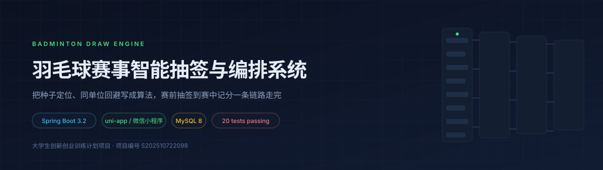
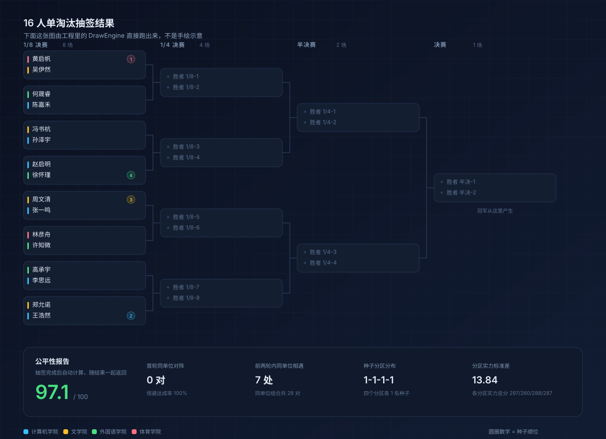
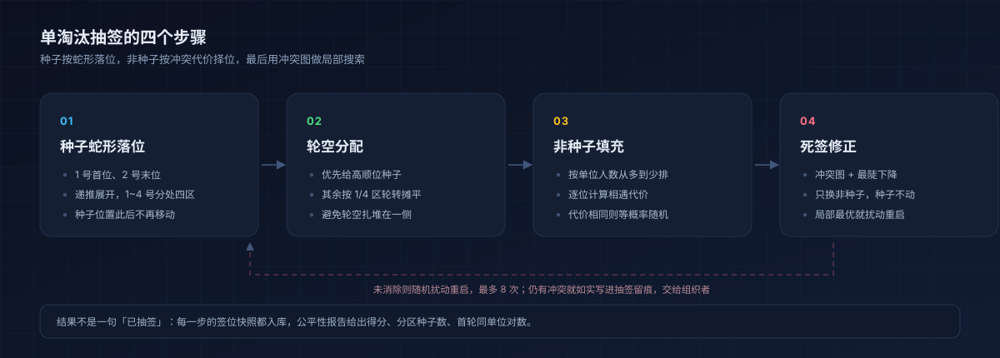
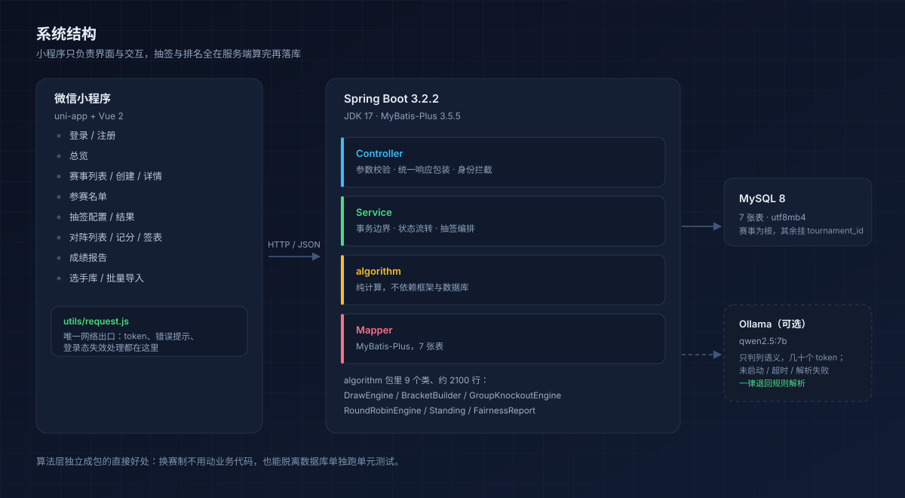

<div align="center">
  
</div>

<p align="center">
  <a href="README.md">中文</a> · <b>English</b>
</p>

<p align="center">
  
  
  
  
  
  
</p>

A WeChat mini program plus Spring Boot backend for running badminton tournaments: roster import, seeded draw, match scoring, advancement and result reports.

Most campus tournaments are still drawn with paper lots and scheduled in Excel. Once the entry list grows, three things go wrong: nobody can prove the seeds were spread evenly, two players from the same department meet in round one, and changing one entry means rebuilding the whole bracket.

This project turns those rules into computation. The drawing algorithm lives in its own package with no Spring and no database imports, so it can be unit tested on its own.

## What a draw looks like



The image above is not an illustration. It is rendered from the actual output of `DrawEngine` on a 16-player roster: four seeds in four quarters, zero same-team pairings in round one, fairness score 97.1. The same engine is covered by 19 unit tests.

- Seed 1 is pinned to the top of the bracket, seed 2 to the bottom, so they can only meet in the final
- Seeds 3 and 4 land in the middle of each half, one seed per quarter
- Placement order comes from a recursive snake table, not a lookup table

## Features

| | Feature | Notes |
|---|---|---|
| 🎯 | Seeded draw | Snake placement for seeds, cost-based placement for the rest, conflict-graph local search for dead draws |
| 🧮 | Two formats | Single elimination, and group round robin into cross knockout |
| 🏸 | Five events | Men's/women's singles, men's/women's doubles, mixed doubles |
| 📋 | Roster import | Excel or pasted text, rule parser as fallback, optional local LLM for column semantics |
| ✍️ | Scoring | Best of 1 or 3, walkover, corrections on finished matches |
| 🔁 | Auto advancement | Each match stores where the winner and loser go |
| 📊 | Fairness report | 0 to 100, split into seed spread, strength balance, team avoidance, bye balance |
| 🧾 | Draw trace | A position snapshot after every step, so a draw can be replayed |
| 🏅 | Reports | Entries, department distribution, completion rate, medal list, group standings |

## How the draw works



1. **Seed placement.** `seedingOrder(8)` returns `[1,8,5,4,3,6,7,2]`, `seedingOrder(16)` returns `[1,16,9,8,5,12,13,4,3,14,11,6,7,10,15,2]`. Seeds are frozen after placement.
2. **Bye allocation.** Byes go to the highest seeds first, the remainder is spread across quarters, and nobody receives two byes in a row.
3. **Non-seed filling.** Players from larger departments are placed first. Each candidate slot is scored by the earliest round in which a same-team meeting could happen. Ties are broken by reservoir sampling, so randomness survives.
4. **Dead draw repair.** Remaining same-team first-round pairs become a conflict graph. Steepest descent with random restarts swaps non-seeds only, so seed positions are never disturbed. If eight restarts cannot clear it, the conflict is recorded instead of hidden.

### Pairwise rounds instead of padding to a power of two

A 10-player draw is often padded to 16 slots, which shows eight first-round matches of which only five can be played. Here each round pairs whoever is left, and one player gets a bye when the count is odd:

| Entries | Rounds | Byes | Real matches |
|---|---|---|---|
| 8 | 3 | 0 | 7 |
| 10 | 4 | 2 | 9 |
| 16 | 4 | 0 | 15 |
| 20 | 5 | 2 | 19 |

Real matches always equal `n - 1`, with the third-place match counted separately.

### Fairness score

Seed spread 35, strength balance 30, same-team avoidance 25, bye balance 10. The score is for review only; a low score does not trigger an automatic redraw.

## Structure



```
backend/            Spring Boot 3.2.2, JDK 17, MyBatis-Plus, 7 tables, 40 endpoints
  algorithm/        9 classes, ~2100 lines, framework free
badminton/          uni-app + Vue 2 mini program, 16 pages, 5 shared components
docs/               deployment guide, testing checklist, paper
sample-data/        Excel rosters for import testing
```

## Quick start

```bash
mysql -uroot -p --default-character-set=utf8mb4 < backend/src/main/resources/schema.sql
export MYSQL_USERNAME=root MYSQL_PASSWORD=your_password
cd backend && mvn spring-boot:run     # port 8083
```

```bash
curl -X POST http://127.0.0.1:8083/api/user/login \
  -H "Content-Type: application/json" \
  -d '{"username":"wenchenyao","password":"123456"}'
```

Open `badminton/` in HBuilderX and run it into WeChat DevTools with domain checking disabled. For a real phone, switch the API base to your LAN IP and use **remote debugging** rather than preview: preview enforces the domain whitelist, so a local HTTP address can never pass.

## Tests

```bash
cd backend && mvn test
# Tests run: 20, Failures: 0, Errors: 0, Skipped: 0
```

The random seed can be fixed, so the same roster and parameters reproduce the same draw, which makes regressions comparable.

## Known limitations

- Passwords are stored in plain text (demo only, use BCrypt before shipping)
- Tokens live in memory, so a restart logs everyone out (use JWT plus Redis)
- Registration lets the user pick an admin role, which is for demos
- The API is plain HTTP, WeChat requires a filed HTTPS domain for release
- The mini program main package is about 1.7 MB against a 2 MB limit
- Team events are not implemented
- No realtime push between scoring devices

## Docs

- [Deployment guide (Chinese)](docs/deployment-guide.docx)
- [Testing checklist (Chinese)](docs/local-testing.md)
- [Project paper (Chinese)](docs/paper.pdf)

## ☕ Support

No ads, no paywall, MIT licensed. If it saves you an afternoon of bracket drawing, you can buy me a coffee. Entirely optional.

<table align="center">
  <tr>
    <td align="center" width="240"><br><b>Alipay</b></td>
    <td align="center" width="240"><br><b>WeChat Pay</b></td>
  </tr>
</table>

## License

[MIT](LICENSE)
